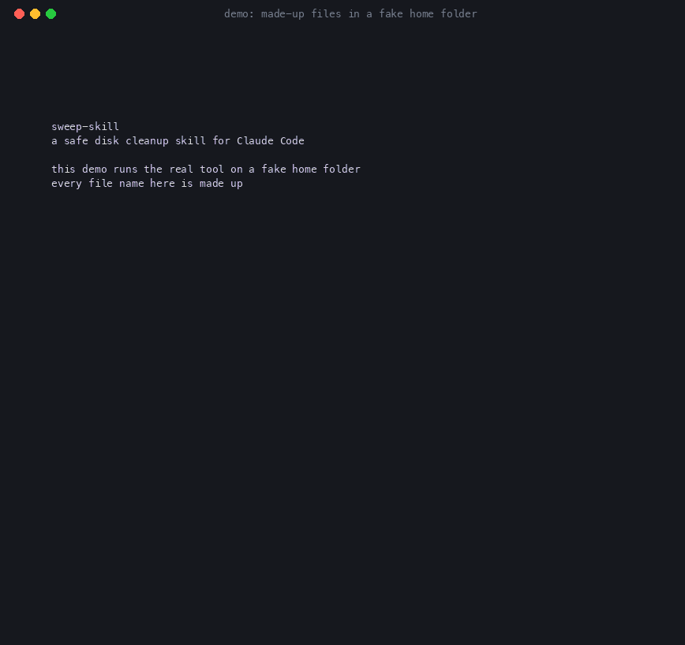

# sweep-skill: a safe disk cleanup skill for Claude Code



*The demo runs the real tool on a fake home folder. Every file name is made up.*

A Claude Code skill that frees disk space on a Mac. It gives insights, not just a file list.

- **Finds** idle projects, rebuildable `node_modules` and build folders, Xcode simulator runtimes,
  caches, and big downloads.
- **Separates** what is safe to remove from the only copy of your work (shown as KEEP, never offered).
- **Shows** a chart dashboard in the chat, and an optional visual HTML report you can tick through.
- **Finds the leaks** other cleaners miss: temp folders a tool never cleans, apps unused for a year.
- **Moves** personal files to a pendrive or hard disk with a checksum check, then Trashes the original.
- **Deletes** only after a dry run and a token, with hard safety checks and an audit log.

**Beta.** Tested on one Mac (macOS 26). Always read the dry run. No warranty.

## Install

```
git clone https://github.com/BisheshS/sweep-skill ~/.claude/skills/disk-cleanup
```

Needs Claude Code, macOS and Python 3.9+. Then open Claude Code and say "free up space". Then say "free up space".

Protect a folder forever: add an empty file named `.disk-cleanup-keep` inside it.

Everything runs locally. Nothing is uploaded. Needs macOS and Python 3.9+. No packages to install.
Test the safety layers: `python3 tests/test_guards.py`.

## Make the demo yourself

```
bash demo/run_demo.sh /tmp/demo-run                 # builds a fake home, runs the real tools in it
python3 demo/render_gif.py /tmp/demo-run demo.gif   # needs Pillow (maintainers only)
```

`demo/build_sandbox.py` refuses to run on your real home folder.
